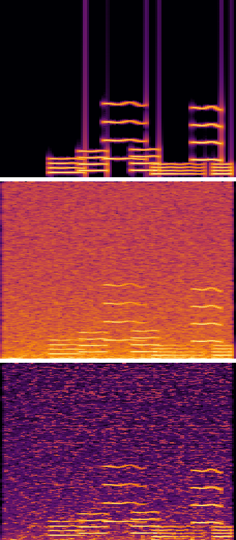

# CUDA Spectral Denoiser

A GPU audio-denoising pipeline that removes background noise from **hundreds
of audio clips in a single run**. Each clip is transformed into the
frequency domain with batched **cuFFT** transforms. The noise spectrum is
learned from the clip's first quarter second and subtracted bin by bin in a
custom CUDA kernel, and the cleaned audio is rebuilt with a gather-style
overlap-add kernel. A shared-memory reduction kernel measures how much
cleaner every clip became (signal-to-noise ratio, SNR).

```
noisy .wav files
   │  pack many clips into one GPU buffer
   ▼
FrameAndWindowKernel ─► cuFFT R2C (batched) ─► NoiseProfileKernel ─► SpectralGainKernel
                                                                          │
cleaned .wav files ◄─ download ◄─ SnrReductionKernel ◄─ OverlapAddKernel ◄─ cuFFT C2R (batched)
```

This is my capstone project for the Coursera **GPU Programming
Specialization**. It builds on the cuFFT lab from the course and adds a
complete, measurable signal-processing application around it.

---

## Highlights

| What | How |
|---|---|
| Large batch | 240 clips (534.5 s of audio, 8.5 million samples, 34,237 STFT frames) denoised in one execution |
| GPU libraries | cuFFT `cufftPlanMany` batched real-to-complex and complex-to-real transforms over all frames of all clips at once |
| Custom CUDA kernels | `FrameAndWindowKernel`, `NoiseProfileKernel`, `SpectralGainKernel`, `OverlapAddKernel`, `SnrReductionKernel` |
| Batching | Clips are packed into chunks of up to `--batch_frames` STFT frames; a lookup table maps each frame to its clip, so clips of different lengths share one cuFFT call |
| Shared memory | `SnrReductionKernel` uses one block per clip and a shared-memory tree reduction to compute three energy sums per clip on the GPU |
| No atomics | Overlap-add is written as a *gather*: each thread computes one output sample by reading the 4 frames that cover it, instead of 4 frames scattering into it with `atomicAdd` |
| Measured results | SNR before and after for every clip (`logs/results.csv`), with the GPU time of every stage measured by CUDA events |
| Correctness | The DSP math (`src/dsp_common.h`, `__host__ __device__`) is shared with a CPU reference that has its own radix-2 FFT; `--verify` compares every output sample |
| Engineering | Command-line options, `Makefile`, `run.sh`, a reproducible dataset generator, Google C++ style (passes `cpplint`) |

---

## The algorithm: STFT spectral subtraction

1. **Short-time Fourier transform (STFT).** Each clip is cut into
   overlapping frames of N = 1024 samples (64 ms at 16 kHz), one every
   H = 256 samples (75% overlap). Each frame is multiplied by a Hann window
   and transformed with an FFT into 513 frequency bins.
2. **Noise profile.** The first 250 ms of every clip contain only noise. The
   average magnitude of those frames, per frequency bin, is the clip's noise
   spectrum |N(k)|.
3. **Spectral subtraction.** Each bin is scaled by a gain
   `G = max(1 − α·|N(k)| / |X(k)|, floor)` with α = 1.5 (over-subtraction)
   and floor = 0.05. Bins much louder than the noise keep G ≈ 1, and bins at
   the noise level are pushed down to the floor.
4. **Inverse STFT.** An inverse FFT of every frame, then a weighted
   overlap-add with the same Hann window, normalized by the summed squared
   window. With the gain fixed at 1, this reconstructs the input exactly.
5. **Evaluation.** Because the dataset is synthetic, the clean signal is
   known, so the program reports SNR = 10·log10(Σclean² / Σ(estimate − clean)²)
   before and after denoising.

## Quick start

On a machine with an NVIDIA GPU and the CUDA toolkit (for example Google
Colab with a T4 GPU, or the course lab):

```bash
bash run.sh
```

`run.sh` will

1. build `bin/denoise` and `bin/generate_audio_dataset` (`make build`),
2. generate the dataset in `data/` on the first run (`make data`),
3. denoise every clip on the GPU with verification turned on, and write
   - `output/denoised/*.wav`: the cleaned version of every clip,
   - `output/examples/`: listening examples (`*_0_clean.wav`, `*_1_noisy_input.wav`, `*_2_denoised_output.wav`),
   - `output/spectrograms/*_spectrogram.png`: clean / noisy / denoised spectrograms,
   - `logs/run_log.txt`: one line per clip (SNR before → after, verification),
   - `logs/results.csv`: the same results as a CSV,
   - `logs/summary.md`: totals, GPU time per stage, speedup.

Any extra arguments are passed on, for example
`bash run.sh --frame_size 2048 --over_subtraction 2`.

### Running on Google Colab

```python
# Runtime -> Change runtime type -> T4 GPU, then:
!git clone https://github.com/Adhiraj-Singh1/cuda-spectral-denoiser.git
%cd cuda-spectral-denoiser
!bash run.sh
```

Colab already has `nvcc`, cuFFT, `g++` and `make` installed; nothing else is
needed.

## Building manually

```bash
make                     # bin/denoise and bin/generate_audio_dataset
make data                # 240 clean/noisy clip pairs in data/
make run ARGS="--verify"
make clean               # remove build products
make clean-all           # also remove data, outputs and logs
make ARCH="-arch=sm_75"  # optional: build for a specific GPU
```

Requirements: CUDA toolkit 11 or newer (`nvcc` and cuFFT), `g++` with C++17,
and `make`. PNG writing uses the single-header
[stb_image_write](https://github.com/nothings/stb) (public domain / MIT)
in `third_party/stb`. WAV reading and writing is implemented in
`src/wav_io.cc`.

## Command line

```
./bin/denoise [options]
```

| Option | Default | Description |
|---|---|---|
| `-i, --noisy_dir DIR` | `data/noisy` | Noisy input `.wav` files (8/16/24/32-bit PCM or float; stereo is mixed down to mono) |
| `-c, --clean_dir DIR` | `data/clean` | Clean references with the same file names, used for SNR. `""` skips the SNR measurement |
| `-o, --output_dir DIR` | `output` | Output folder |
| `-l, --log_file FILE` | `logs/run_log.txt` | Per-clip log (also printed to the screen) |
| `-S, --summary_file FILE` | `logs/summary.md` | Markdown summary |
| `-r, --results_csv FILE` | `logs/results.csv` | Per-clip results |
| `-f, --frame_size N` | `1024` | STFT frame size (power of two, 64–8192) |
| `-H, --hop N` | frame/4 | STFT hop (1 to frame/2) |
| `-N, --noise_ms MS` | `250` | Length of the noise-only lead-in used for the noise profile |
| `-a, --over_subtraction F` | `1.5` | α in the gain formula (0–10) |
| `-g, --gain_floor F` | `0.05` | Lowest gain for any bin (0–1) |
| `-b, --batch_frames N` | `16384` | STFT frames per GPU chunk (bounds GPU memory, about 14 KB per frame) |
| `-m, --max_clips N` | all | Process only the first N clips |
| `-G, --gallery N` | `6` | Spectrogram images and listening examples to write |
| `-d, --device N` | auto | GPU index (default: the GPU with the most SMs) |
| `-v, --verify` | off | Run the CPU reference on every clip and compare |
| `-h, --help` | | Show help |

## Dataset

`tools/generate_audio_dataset.cc` writes a reproducible dataset (seed 2026):
240 clips of 1.5–3 s at 16 kHz. Each clean clip is a short melody of
harmonic notes with attack/decay envelopes and vibrato, after a 0.35 s silent
lead-in. The noisy version adds **white or pink noise** at a random
**SNR between 0 and 10 dB**. `data/dataset.csv` lists the noise type and
target SNR of every clip. The audio files are not committed (34 MB);
`make data` recreates exactly the same files. Any folder of real recordings
also works, as long as each starts with about 0.25 s without speech or
music.

## Proof of execution

After `bash run.sh`, the following are committed to the repository:

* [`logs/run_log.txt`](logs/run_log.txt): the GPU used, one line per clip (240 lines), and the summary
* [`logs/results.csv`](logs/results.csv): SNR before/after for every clip
* [`logs/summary.md`](logs/summary.md): totals, GPU time per stage, speedup, verification
* [`output/denoised/`](output/denoised): all 240 denoised clips
* [`output/examples/`](output/examples): before/after listening examples
* [`output/spectrograms/`](output/spectrograms): spectrograms. Each image shows the **clean** signal on top, the **noisy** input in the middle and the **denoised** output at the bottom (time →, frequency ↑):



## Code structure

```
src/
  main.cu              driver: device selection, chunking, outputs, logging, summary
  denoise_pipeline.cu  CUDA kernels, cuFFT plans, buffers and stage timing
  denoise_pipeline.cuh
  dsp_common.h         __host__ __device__ STFT geometry, Hann window, gain
  cpu_reference.cc     CPU FFT + the same denoiser (verification, speedup)
  cpu_reference.h
  wav_io.cc            WAV reading/writing, directory listing
  wav_io.h
  spectrogram_png.cc   spectrogram rendering (stb_image_write)
  spectrogram_png.h
  cli_options.cc       getopt_long parsing and validation of the arguments
  cli_options.h
tools/
  generate_audio_dataset.cc   synthetic clean/noisy dataset generator
third_party/stb/stb_image_write.h
Makefile, run.sh
```

## Design notes

* **Batched cuFFT across clips.** Instead of one FFT call per clip, every
  frame of every clip in a chunk is transformed by one `cufftPlanMany` call
  (thousands of 1024-point FFTs at once), which keeps the GPU busy even
  though each clip is short.
* **Frame-to-clip lookup table.** Clips have different lengths, so a small
  `int` table tells each frame which clip it belongs to. Every kernel stays
  a flat, fully parallel loop over frames, bins or samples.
* **Gather overlap-add.** Each output sample is covered by exactly
  N / H = 4 frames. Computing a sample by reading those 4 frames avoids the
  write conflicts (and atomics) that a scatter approach would need.
* **Exact reconstruction.** Frames start N − H samples before the clip, so
  every sample is covered by the same number of frames. Weighted overlap-add
  (window applied twice, divided by Σw²) then reconstructs the input exactly
  when the gain is 1.

## License

MIT, see [LICENSE](LICENSE). stb_image_write by Sean Barrett (public domain
/ MIT).
